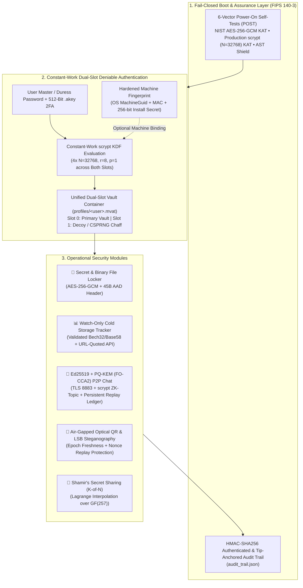

# 🛡️ Kyberon v4.1.0 — Zero-Trust, Post-Quantum Cold Storage & Air-Gapped Privacy Workstation

[](https://github.com/yiitpepek/Kyberon/releases)
[](https://www.python.org/)
[-10b981?style=for-the-badge)](https://csrc.nist.gov/publications/detail/sp/800-38d/final)
[-f59e0b?style=for-the-badge)](https://datatracker.ietf.org/doc/html/rfc7914)
[-0284c7?style=for-the-badge)](#-security-audit--acknowledgments-v410-hardening)
[](LICENSE)

**Kyberon** is an open-source, zero-trust cryptographic workstation engineered for **cold-storage secret management**, **dual-slot deniable encryption**, **air-gapped optical/steganographic transport**, and **Ed25519-authenticated end-to-end encrypted (E2EE) communications**.

Built around **NIST SP 800-38D (AES-256-GCM)**, **RFC 7914 (`scrypt`)**, **Ed25519 (RFC 8032)**, **Fujisaki-Okamoto IND-CCA2 Post-Quantum Hybrid KEM (`X25519 + Ring-LWE`)**, and **Bitcoin BIP-38 / BIP-39**, Kyberon v4.1.0 incorporates comprehensive security hardening following an independent white-box cryptographic audit.

---

## 📑 Table of Contents

1. [Security Audit & Acknowledgments (v4.1.0 Hardening)](#-security-audit--acknowledgments-v410-hardening)
2. [Architectural Overview](#-architectural-overview)
3. [Core Cryptographic & Operational Modules](#-core-cryptographic--operational-modules)
4. [Mathematical Foundations & Cryptographic Primitives](#-mathematical-foundations--cryptographic-primitives)
5. [Binary Capsule & Wire Protocol Specifications](#-binary-capsule--wire-protocol-specifications)
6. [Threat Model & Explicit Security Boundaries](#-threat-model--explicit-security-boundaries)
7. [Repository Structure](#-repository-structure)
8. [Installation, Usage & Compilation](#-installation-usage--compilation)
9. [Automated Self-Tests & Verification](#-automated-self-tests--verification)

---

## 🔒 Security Audit & Acknowledgments (v4.1.0 Hardening)

We extend our sincere gratitude to independent security researcher **[@taygun08](https://github.com/taygun08)** for conducting an exhaustive, 22-finding white-box cryptographic and architectural security audit of Kyberon v4.0.0 (`V-01..V-20`, `W-01`, `W-02`) complete with 18 reproducible Proof-of-Concept (PoC) scripts ([PR #1](https://github.com/yiitpepek/Kyberon/pull/1)).

All **22 findings** have been addressed and verified in **Kyberon v4.1.0**:

| Finding ID | Audit Discovery | v4.1.0 Remediation Summary |
| :--- | :--- | :--- |
| **V-01** | Offline `.mvat` cracking bypasses GUI-layer rate-limiting / wipe policies | Documented explicit offline vs. interactive threat boundaries; offline resistance relies on `scrypt` ($N=2^{15}, 32\text{ MB}$), OS-protected local installation secrets, and 512-bit 2FA `.akey` keyfiles. |
| **V-02** | `.security_state.json` used a predictable HMAC key and failed open on mismatch | Replaced with a 256-bit CSPRNG secret key stored in user-scoped protected storage + sealed rollback digest; `_load_security_state()` now **fails closed** (`VaultSecurityError`) on any tamper or deletion. |
| **V-03** | Global `_failed_attempts` counter leaked across profiles | Replaced global scalar with strict per-profile dictionaries (`_profile_failed_attempts[profile]`), eliminating cross-profile Scorched-Earth triggers. |
| **V-04** | Unauthenticated `[PQ-KEM-ACK]` allowed active room peers to hijack the PQ ratchet | Added mandatory **Ed25519** packet signatures, `syn_id` nonce binding, and HMAC key-confirmation tags (`AEGIS-PQ-ACK-CONFIRM`) to all PQ-KEM handshakes. |
| **V-05** | Plain SHA-256 audit chain could be rewritten or deleted | Upgraded `CryptographicAuditTrail` to **HMAC-SHA256** using a secret audit key and a sealed in-memory/disk tip anchor that detects both block forgery and log deletion/truncation. |
| **V-06 / V-08** | `emergency_zeroize_vault()` was vulnerable to path traversal and swallowed I/O errors | Added strict traversal rejection (`..`, `/`, `\`), `os.path.realpath` containment inside `profiles/`, and fail-closed verification returning `False` + `EMERGENCY_ZEROIZE_FAILED` if no file existed or any pass/unlink failed. |
| **V-07 / V-14** | Separate `_decoy.mvat` file exposed duress vaults on disk and leaked via KDF timing | **Unified Dual-Slot Container:** Every `.mvat` file now embeds **2 encrypted slots** (Primary + Decoy/Chaff) inside a single file—zero `_decoy.mvat` files ever touch disk. `unlock_vault()` executes a **constant number of `scrypt` derivations** across both slots without early return. |
| **V-09** | Dead-Man's Switch skipped execution when `last_checkin_epoch <= 0` | Enforced fail-closed evaluation: if `dms_days > 0` and `last_checkin_epoch <= 0` or is future-skewed, DMS triggers immediately. |
| **V-10** | Auto-updater accepted unsigned binaries without `expected_sha256` | `apply_executable_update()` now **mandates** a valid 64-hex `expected_sha256`, enforces repository path pinning (`/yiitpepek/aegisvault/releases/download/`), and verifies the full Windows PE `MZ` + `e_lfanew` $\rightarrow$ `PE\0\0` header. |
| **V-11** | FIPS 140-3 POST results were not enforced and logged unconditional success | Startup now enforces fail-closed execution on POST failure (`RuntimeError` + `POST_BOOT_FAILURE` CRITICAL audit entry) and defaults the status badge to `False`. |
| **V-12** | Substring-based backdoor shield missed `app.py` and `getattr` obfuscation | Upgraded `verify_runtime_backdoor_shield()` to parse all 12 `.py` modules (including `app.py`) via Python's **`ast` (Abstract Syntax Tree)**, blocking indirect `getattr(...)()`, `eval`, `exec`, `__import__`, `os.system/popen`, and `pickle/marshal`. |
| **V-13** | Hardware fingerprint relied solely on public hostname/architecture | Hardened `get_hardware_fingerprint()` with OS `MachineGuid` / `/etc/machine-id`, hardware MAC node, and a persistent 256-bit CSPRNG installation secret. |
| **V-15** | P2P chat lacked cryptographic sender authentication and persistent replay cache | Added per-session **Ed25519** signing (`_sign_packet` / `_verify_packet_signature`), **TOFU (Trust-On-First-Use)** public-key pinning per username, and an on-disk packet replay ledger surviving restarts. |
| **V-16** | `crypto_chat.decrypt_message()` did not validate `epoch` age or `nonce` reuse | Added mandatory epoch freshness checks (`max_age_seconds=86400`) and a persistent consumed-nonce cache directly inside `crypto_chat.decrypt_message()`, protecting P2P, Steganography, and Optical QR paths alike. |
| **V-17** | `fetch_live_btc_balance()` interpolated unvalidated addresses into URLs | Enforced in-function `validate_crypto_address("BTC", addr)` and `urllib.parse.quote(addr, safe="")` prior to any HTTP request. |
| **V-18** | CPython `str`/`bytes` immutability limits in-place RAM zeroization | Upgraded `_zero_memory()` with `ctypes.memset` for mutable buffers and documented CPython's immutable string allocation semantics transparently. |
| **V-19** | Profile name sanitization caused silent file collisions (`a.b` vs `ab`) and homoglyphs | Applied `NFKC` normalization, path traversal rejection, ASCII allowlisting, and a deterministic 8-hex `SHA-256` disambiguation suffix whenever non-canonical characters are present. |
| **V-20** | POST `scrypt` KAT used $N=1024$ instead of production $N=32768$ | Updated POST Test #2 to verify `Scrypt` under exact production parameters ($N=32768, r=8, p=1$). |
| **W-01** | Hardcoded default P2P credentials + fast HMAC topic acted as an offline oracle | Removed hardcoded default room/passkey from `app.py`, switched MQTT relay default to **TLS port 8883**, and hardened `derive_zk_topic()` with **memory-hard `scrypt` ($N=32768, r=8, p=1$)**. |
| **W-02** | Custom Ring-LWE KEM lacked coefficient validation and IND-CCA2 FO transform | Enforced strict integer type and range validation ($\text{coeff} \in [0, 3328]$) and implemented the **Fujisaki-Okamoto (FO) IND-CCA2 re-encryption transform** in `PQHybridKEM.decapsulate()`. |

---

## 🏗️ Architectural Overview



---

## 🚀 Core Cryptographic & Operational Modules

### 1. 🔑 Zero-Trust Cold Storage Vault & Binary File Locker ([`military_vault.py`](military_vault.py), [`vault_storage.py`](vault_storage.py))
* **Authenticated Encryption (AEAD):** Every secret, seed phrase, private key, and embedded binary document (PDF, Office, keystores up to 15 MB) is sealed with **AES-256-GCM** using a unique 96-bit CSPRNG nonce and a 128-bit Galois (`GHASH`) authentication tag.
* **Header-Bound AAD:** The 45-byte binary header (`MVAULT` magic bytes, version, KDF parameters, 128-bit salt, 96-bit nonce) is cryptographically bound as **Associated Authenticated Data (AAD)**.

### 2. 🎭 Indistinguishable Dual-Slot Plausible Deniability ([`vault_storage.py`](vault_storage.py), [`app.py`](app.py))
* **Unified Dual-Slot `.mvat` Container (`V-14`):** Both the primary vault (Slot 0) and the duress/decoy vault (Slot 1) are stored inside a single `<profile>.mvat` file. Even when a user does not configure a duress password, `init_vault()` populates Slot 1 with an indistinguishable CSPRNG chaff capsule—ensuring zero `_decoy.mvat` files ever exist on disk.
* **Constant-Work Authentication (`V-07`):** During `unlock_vault()`, every candidate key is evaluated against **both Slot 0 and Slot 1** without early return, executing an identical number of `scrypt` derivations whether the Master password, Duress password, or an invalid password is supplied.

### 3. 💻 Hardened Machine Fingerprint & 🔑 512-Bit 2FA USB Keyfile ([`vault_storage.py`](vault_storage.py))
* **Multi-Source Machine Binding (`V-13`):** Combines the OS `MachineGuid` (Windows Registry) / `/etc/machine-id`, hardware MAC address node, processor architecture, and a 256-bit local installation secret stored outside the workspace.
* **512-Bit CSPRNG 2FA USB Keyfile (`.akey`):** Generates a 512-bit hardware-random cryptographic token (`.akey`) whose 256-bit `SHA3-256` digest (`|KF:<digest>`) is mixed into the `scrypt` key derivation.

### 4. 💬 Ed25519-Authenticated E2EE P2P Chat & ⚛️ FO-CCA2 Post-Quantum Hybrid KEM ([`live_p2p_chat.py`](live_p2p_chat.py), [`crypto_utils.py`](crypto_utils.py))
* **`scrypt`-Hardened Zero-Knowledge Blinded Topics (`W-01`):** Room topics are derived via `Scrypt(N=32768, r=8, p=1)` + `HMAC-SHA256` (`derive_zk_topic`) over **TLS Port 8883**, neutralizing high-speed offline dictionary attacks against observed MQTT topics.
* **Ed25519 Sender Signatures & TOFU Key Pinning (`V-15`):** Every P2P message and handshake packet is signed with the sender's **Ed25519** private key and verified under Trust-On-First-Use (TOFU) public-key pinning, preventing sender spoofing by malicious room peers.
* **⚛️ IND-CCA2 Post-Quantum Hybrid KEM (`V-04`, `W-02`):** Combines classical **X25519 ECDH** with lattice-based **Ring-LWE over $\mathbb{Z}_{3329}[X]/(X^{256}+1)$** protected by strict coefficient validation ($\in [0, 3328]$), the **Fujisaki-Okamoto (FO) re-encryption transform**, and `syn_id` HMAC key confirmation.

---

## 📐 Mathematical Foundations & Cryptographic Primitives

### 1. Memory-Hard Key Derivation (`scrypt` — RFC 7914)
Master keys and blinded P2P topic keys are derived via `scrypt` with parameters $N = 2^{15} = 32768$, $r = 8$, $p = 1$ ($32\text{ MB}$ sequential RAM matrix per evaluation):

$$K_{\text{AES}} = \text{scrypt}\left(P_{\text{eff}}, S_{128}, N=2^{15}, r=8, p=1, \text{dkLen}=32\right) \in \{0,1\}^{256}$$

### 2. Authenticated Encryption (AES-256-GCM — NIST SP 800-38D)
Given the 256-bit key $K_{\text{AES}}$, 96-bit CSPRNG nonce $IV \in \{0,1\}^{96}$, 45-byte header $A$ (AAD), and plaintext $P$:

$$(C, T) = \text{AES-256-GCM-Enc}(K_{\text{AES}}, IV, P, A), \quad T \in \{0,1\}^{128}$$

### 3. Shamir's Secret Sharing over Prime Field $\mathbb{F}_{257}$
For each secret byte $a_0 \in [0, 255]$, $K-1$ uniform random coefficients define $P(x) = \left( a_0 + \sum_{m=1}^{K-1} a_m x^m \right) \bmod 257$ with rejection sampling into $[0, 255]$, reconstructed via Lagrange interpolation at $x=0$.

### 4. Fujisaki-Okamoto (FO) Post-Quantum Hybrid KEM ($\mathcal{R}_{3329} = \mathbb{Z}_{3329}[X]/(X^{256}+1)$ + X25519)
Encapsulation derives deterministic LWE coins $c = \text{SHA3-256}(m \parallel H(pk))$ and computes $(u, v)$. During decapsulation, the recovered 256-bit seed $m'$ is re-encapsulated using $c' = \text{SHA3-256}(m' \parallel H(pk))$; if $(u', v') \neq (u, v)$ or any coefficient falls outside $[0, 3328]$, decapsulation immediately aborts with `ValueError`, providing IND-CCA2 defense against malformed capsule attacks (`W-02`).

---

## 📦 Binary Capsule & Wire Protocol Specifications

### 1. Unified Dual-Slot `.mvat` Container Format
Each `.mvat` file consists of two newline-delimited Base64 `MVAULT` capsules (Slot 0 and Slot 1). Each capsule begins with a 45-byte big-endian header (`>6sBBBII16s12s`) bound as GCM AAD:
* `Magic` (6B): `MVAULT` | `Version` (1B): `0x01` | `KDF` (1B): `0x01` (`scrypt`)
* `log_n` (1B): `15` | `r` (4B): `8` | `p` (4B): `1` | `Salt` (16B) | `Nonce` (12B)

---

## 🛡️ Threat Model & Explicit Security Boundaries

To provide transparent, verifiable security guarantees, Kyberon distinguishes between **offline cryptographic guarantees** and **interactive application-layer defenses**:

1. **Offline Adversary (Stolen `.mvat` Container / Disk Image — `V-01`):**
   * When an attacker extracts a `.mvat` file and attacks it offline (e.g., calling `MilitaryVault.decrypt()` directly or using custom GPU rigs without running the Kyberon GUI), interactive policies (rate-limiting, Scorched-Earth auto-wipe, Dead-Man's Switch) are **not** in the execution path.
   * **Offline protection** relies strictly on:
     1. **`scrypt` Memory-Hardness** ($N=32768, r=8, p=1 \rightarrow 32\text{ MB RAM}$ per guess),
     2. **512-Bit CSPRNG 2FA Keyfile (`.akey`)** stored on a separate physical USB token (adds 256 bits of `SHA3-256` entropy to the KDF input), and
     3. **Hardened Machine Binding** (incorporating a 256-bit local installation secret stored outside the vault directory).
2. **Interactive / Physical Seizure Adversary (`V-02`, `V-03`, `V-07`, `V-09`, `V-14`):**
   * Against an adversary interacting with the workstation or compelling password disclosure:
     * **Dual-Slot Container & Constant-Work Unlock** prevent filesystem or timing identification of Duress mode.
     * **Fail-Closed HMAC Security State** blocks counter/policy tampering on `.security_state.json`.
     * **Dead-Man's Switch & Per-Profile Scorched-Earth Wipe** perform verified 3-pass overwrite + unlinking of the target profile container. *(Note: On modern NVMe/SSD wear-leveling or Copy-on-Write filesystems, file-level overwriting is best-effort logical sanitization; full-disk encryption such as BitLocker/LUKS is recommended for physical flash media protection.)*
3. **Runtime Memory Hygiene (`V-18`):**
   * `MilitaryVault._zero_memory()` zeroes mutable `bytearray` and `memoryview` buffers in-place via `ctypes.memset`. Because CPython's `str` and `bytes` types are immutable managed heap objects, residual copies in the Python allocator cannot be guaranteed zeroed until process termination; `Ctrl+Shift+L` locks the session and clears active references immediately.

---

## 📂 Repository Structure

```text
Kyberon/
├── app.py                # Main CustomTkinter GUI, fail-closed POST enforcement & panic lock
├── military_vault.py     # Core AES-256-GCM + scrypt AEAD cryptographic engine & ctypes buffer zeroizer
├── vault_storage.py      # Dual-slot deniable container, constant-work unlock, fail-closed HMAC state
├── military_audit.py     # FIPS 140-3 POST KATs, AST anti-backdoor shield & HMAC-anchored audit trail
├── crypto_utils.py       # Shamir GF(257) SSS, BIP-39 validator & FO-CCA2 Post-Quantum Hybrid KEM
├── crypto_chat.py        # AEGIS-MSG-v1 E2EE serializer with enforced epoch freshness & nonce cache
├── live_p2p_chat.py      # TLS 8883 MQTT client, scrypt ZK-topics, Ed25519 signing & TOFU key pinning
├── airgap_crypto.py      # Air-gapped high-density QR generator & Unicode-safe OpenCV decoder
├── steganography.py      # High-speed bytearray LSB image steganography encoder & extractor
├── crypto_portfolio.py   # Watch-only BTC/ETH/SOL validator with URL-quoted Blockchain.info queries
├── updater.py            # Supply-chain hardened updater (mandatory SHA-256 + full PE header check)
├── i18n.py               # Complete trilingual localization dictionary (Turkish, English, Russian)
└── requirements.txt      # Python package dependencies
```

---

## ⚙️ Installation, Usage & Compilation

### Option 1: Standalone Windows Executable (Zero Dependencies)
Download the latest `Kyberon.exe` from the [**GitHub Releases**](https://github.com/yiitpepek/Kyberon/releases) page and launch directly:
```powershell
.\Kyberon.exe
```

### Option 2: Run from Python Source
```bash
git clone https://github.com/yiitpepek/Kyberon.git
cd Kyberon
pip install -r requirements.txt
python app.py
```

### Option 3: Compile Standalone `.exe` via PyInstaller
```powershell
pip install pyinstaller -r requirements.txt
pyinstaller --noconsole --onefile --clean --name "Kyberon" --collect-all customtkinter --collect-all paho --collect-all qrcode --collect-all cv2 --collect-all PIL app.py
```

---

## 🧪 Automated Self-Tests & Verification

Run the built-in cryptographic and FIPS 140-3 POST verification suites from the terminal:

```bash
python military_vault.py
python -c "import military_audit, json; print(json.dumps(military_audit.run_power_on_self_tests(), indent=2))"
```

---

## 📄 License

Distributed under the **MIT License**. Engineered for security research, cryptographic education, and sovereign cold-storage asset protection.

